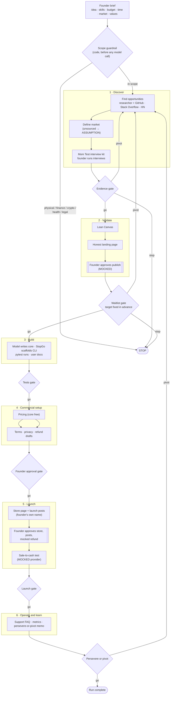
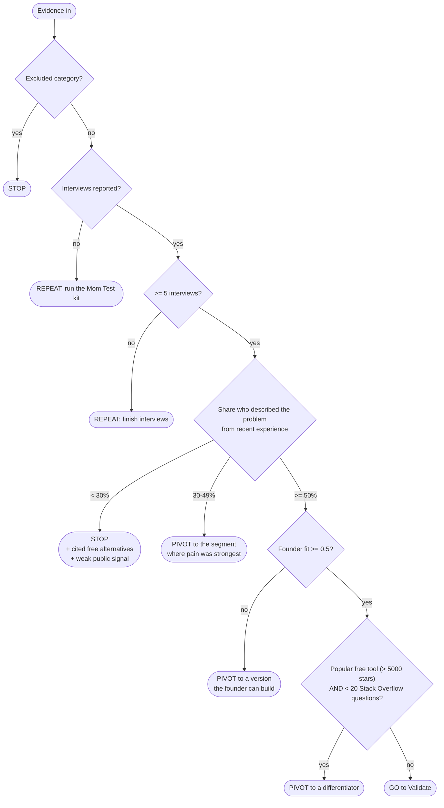
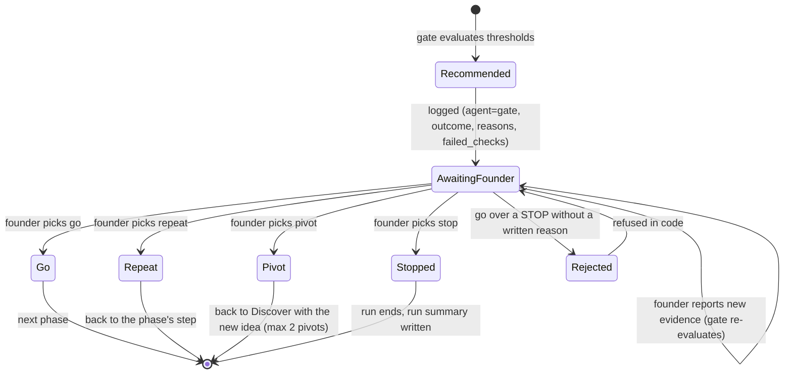
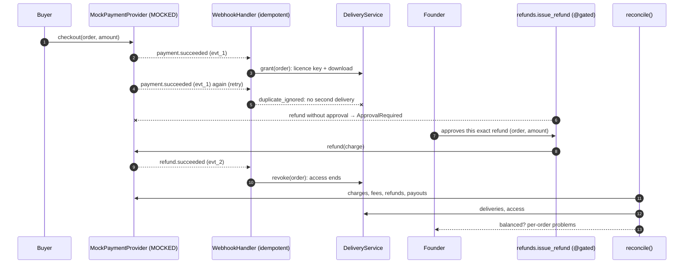

# StopGo architecture

## Overview

StopGo is a resumable pipeline of role agents, gates and founder approvals. The orchestrator walks a fixed list
of nodes (steps, approval points and gates) covering six phases. Agents only produce drafts and analysis; every
outward action sits behind `approval.require()`, which checks that the founder approved that exact content
(SHA-256 of the payload). Gates compare evidence with thresholds written in code before any evidence arrives and
recommend go, repeat, pivot or stop. The founder decides; overriding a STOP needs a written reason. State is
saved after every node, so the pipeline can pause for days (for example while a waitlist test runs) and resume.



Diamonds are gates; double boxes are founder approvals that the code enforces. Every gate also offers
**repeat** (re-run the phase's last step with new evidence or fixes) and **stop**; the founder picks.

Every agent action, gate result and founder decision is appended to `decision_log.json` (timestamp, agent,
action, sources, model, cost, approved_by).

## Phases

### Phase 1: Discover (Core step: find opportunities)

- **Agents:** `researcher` (find and score opportunities, define the market), `interviewer` (Mom Test kit).
- **Tools:** GitHub repository search (free alternatives and their stars), Stack Overflow search (people asking
  about the problem), Hacker News Algolia search (discussion volume). All free, no key, cached per run.
- **Method:**
  1. The model sharpens the idea, proposes two alternative framings inside the founder's constraints, and gives a
     search phrase for each. It never supplies numbers.
  2. StopGo fetches counts for each phrase and scores each candidate with a transparent formula:
     `0.5 * pain + 0.2 * (1 - crowding) + 0.3 * founder_fit`, where pain = log-scaled Stack Overflow questions,
     crowding = log-scaled stars of the strongest free alternative, and founder fit is a rubric over skills,
     hours, budget and market (`gates.founder_fit`). An unreachable source is shown as `unavailable` and the
     candidate is not scored.
  3. Market definition: every bullet without a URL is automatically prefixed `ASSUMPTION:` (`label_claims`).
  4. Interview kit: 7 Mom Test questions about past behaviour, an outreach note for the founder to send
     personally, and a recording sheet (`problem_confirmed`, workaround, spent, referral). StopGo contacts no one.
- **Output:** `phase1_step1_opportunities.md`, `phase1_step2_market.md`, `phase1_step3_interviews.md`,
  `phase1_gate_decision.md`.

### Phase 2: Validate (Core step: design the business)

- **Agent:** `strategist`.
- **Method:** Lean Canvas (9 boxes, all hypotheses), then an honest landing page: it says the product is not
  built yet, has a waitlist form and contains no testimonials, user counts, logos, countdowns or income claims
  (checked by `guardrails.scan_output`). The demand test is fixed before publishing: default 100 waitlist
  sign-ups in 14 days, or the founder's own target.
- **Founder control:** publishing requires approval of the exact page (MOCKED: saved to `runs/<id>/published/`).
- **Output:** `phase2_step1_lean_canvas.md`, `phase2_step2_landing_page.html`, `phase2_gate_decision.md`.

### Phase 3: Build (Core step: build the product)

- **Agent:** `builder`.
- **Tools:** Python, pytest in a subprocess with a timeout, inside the container.
- **Method:** the model writes `process(text) -> str` (standard library only) and three input/expected-output
  examples. StopGo scaffolds a CLI package around it (argparse entry point, `pyproject.toml`, scaffold tests,
  example tests) and runs pytest. On failure the error tail goes back to the model (up to 3 attempts). User docs
  (Install, Use, What it does, Limits) are written into the package README.
- **Gate:** tests must pass and the core must be model-written; a STUBBED core gives REPEAT.
- **Output:** `phase3_step1_mvp_build.md` (files, core code, test output), `phase3_step2_user_docs.md`,
  `phase3_gate_decision.md`; the package itself stays in `runs/<id>/product/`.

### Phase 4: Commercial setup (Core step: set the price and policies)

- **Agents:** `pricer`, `policy_drafter`.
- **Method:** pricing anchored on the free alternatives found in Phase 1 (linked). The code enforces a free tier
  that includes the core feature. Prices are hypotheses; no revenue is projected. Terms, privacy and refund
  drafts are marked "not legal advice"; refunds are always issued by the founder and end paid access.
  No payments of any kind in this phase.
- **Gate:** founder approval of the drafts.
- **Output:** `phase4_step1_pricing.md`, `phase4_step2_policies.md`, `phase4_gate_decision.md`.

### Phase 5: Launch (Core steps: open the store; deliver automatically)

- **Agent:** `launcher`; modules `payments.py`, `webhooks.py`, `delivery.py`, `refunds.py`, `reconcile.py`.
- **Method:** a factual store page (MOCKED checkout banner, pricing table, refund note) and two launch posts
  written in the first person for the founder to post under their own name, disclosing authorship. Opening the
  store and posting each need a separate approval of the exact content (MOCKED: saved locally). Then the
  sale-to-cash test runs end to end on the mocked provider (next section).
- **Gate:** all sale-to-cash checks pass, then founder decision.
- **Output:** `phase5_step1_store_page.html`, `phase5_step1_launch_posts.md`, `payment_test_log.md`,
  `phase5_gate_decision.md`.

### Phase 6: Operate and learn

- **Agent:** `operator`.
- **Method:** support FAQ draft; metrics table that separates founder-reported real buyers from MOCKED test
  numbers; persevere-or-pivot memo (what we learned, what we do not know, next experiment).
- **Gate:** fewer than 10 real buyers gives REPEAT ("not enough data"), never a fabricated verdict.
- **Output:** `phase6_step1_support_and_metrics.md`, `phase6_step2_memo.md`, `phase6_gate_decision.md`.

## Gates

| Gate | Checks (thresholds fixed in `gates.THRESHOLDS`) | Outcomes |
|---|---|---|
| Scope (before Phase 1) | Brief matches an excluded category (physical goods, financial/crypto, health or legal advice) | **stop** immediately |
| Phase 1 evidence | interviews >= 5; share who described the problem from recent experience (go >= 50%, stop < 30%); Stack Overflow questions >= 20; strongest free alternative <= 5000 stars; founder fit >= 0.5 | no interviews or < 5: **repeat**; < 30%: **stop**; 30-49%: **pivot**; weak fit: **pivot**; popular free tool and low public pain: **pivot**; otherwise **go** |
| Phase 2 waitlist | real sign-ups vs the target set before publishing | >= 100%: **go**; 50-99%: **repeat** once with a sharper message; 25-49%: **pivot**; < 25%: **stop** (e.g. 12 of 100 in 14 days) |
| Phase 3 tests | MVP tests pass; core is model-written | pass: **go**; stubbed core or failures: **repeat** (max 3); still failing: **pivot** to smaller scope |
| Phase 4 approval | founder accepts pricing and policy drafts | **go** / **repeat** |
| Phase 5 launch | payment grants access; duplicate webhook does not deliver twice; refund blocked without approval; refund revokes access; reconciliation balances | all pass: **go**; otherwise **repeat** |
| Phase 6 persevere-or-pivot | >= 10 real buyers; refund rate <= 20% | too little data: **repeat**; high refunds: **pivot**; else **go** (persevere) |

### How the Discover gate decides



### What happens after a recommendation



Every founder decision is logged with `approved_by: "founder"`, `recommended`, `override` (true when the
founder chose differently from the recommendation) and the founder's note. The gate file shows the same.

**When StopGo recommends STOP on weak evidence:** the brief is out of scope; fewer than 30% of at least 5
interviewees describe the problem from recent experience; the waitlist reaches less than 25% of a target set in
advance; or the founder has pivoted more than twice. Missing data never counts as a pass: it gives REPEAT with
the exact evidence needed. The founder may override any recommendation; overriding STOP requires a written
reason, and the override is shown in the gate file and the log.

## Sale to cash



- **Payment triggers delivery:** the webhook handler is the only path to `DeliveryService.grant`.
- **Refund revokes access:** `refund.succeeded` calls `revoke`; access checks then fail.
- **Idempotency:** each provider event id is processed once; `grant` also refuses to deliver twice for an
  order. The test replays both the payment and the refund webhook.
- **Reconciliation:** per order it checks charged amount = order amount and access = paid and not refunded;
  overall it checks payout = gross - fees - refunds and no order was delivered more than once.
- **Money:** StopGo never holds, moves or refunds money. The provider is MOCKED (no real or sandbox API); refunds
  run only through `@gated("issue_refund")`, and non-mocked refunds are refused in code.

## Data flow

```
brief (JSON / form) ──> start_run ──> runs/<run_id>/state.json   (brief, evidence, cursor, approvals, gate history)
                                   ├> runs/<run_id>/decision_log.json  (append-only, one entry per action)
                                   ├> runs/<run_id>/evidence_<n>.json  (cached public evidence + URLs)
                                   ├> runs/<run_id>/outputs/phase<N>_step<M>_*.md|html
                                   ├> runs/<run_id>/product/<name>/    (generated MVP + tests)
                                   └> runs/<run_id>/published/         (MOCKED publications, only after approval)
founder (web UI / CLI) ──decide / submit_evidence──> state.json ──advance──> next node
orchestrator.py export <run_id> ──> outputs/ + decision_log.json (the committed demo run)
```

Model calls go to a local Ollama container (`llm.py`); each call's model name, token count and cost ($0) is logged.
Evidence lookups are the only other network calls and are read-only.

## Built vs. stubbed

| Component | State |
|---|---|
| Orchestrator, resumable state, CLI and web UI | Built |
| All six phases with agents and prompts | Built |
| Gates and STOP engine, founder-fit rubric | Built |
| Approval enforcement (payload-hash, founder-only) | Built |
| Guardrails (scope, trick requests, output scan) | Built |
| Public evidence adapters (GitHub, Stack Overflow, Hacker News) | Built |
| MVP generation and test gate | Built (Python CLI tools only) |
| Publishing landing page, store, posts | MOCKED (local files after approval) |
| Waitlist form | MOCKED (founder reports real counts) |
| Payment provider, checkout, payouts | MOCKED |
| Delivery, refunds, idempotency, reconciliation logic | Built, running on MOCKED provider |
| Operate metrics | MOCKED test fixtures plus founder-reported real buyers |
| Model fallback when no model is ready | STUBBED, labelled everywhere |

## Roadmap

1. Real publishing behind the same `@gated` functions: static hosting for the landing and store pages, a form
   provider for the waitlist that reports sign-ups directly to the waitlist gate.
2. A payment provider in test mode first, reusing the webhook, delivery, refund and reconciliation code unchanged.
3. More evidence adapters (package-registry download counts, issue trackers) with the same "URL or unavailable" rule.
4. MVP scaffolds for Node and Go tools; a sandboxed runner for generated code.
5. Evals: a growing set of trick prompts and weak-idea briefs that must end in REPEAT or STOP.
